# Architecture & Device Inspection Findings

This report documents the live reverse-engineering and inspection performed on the connected Android test device (`7461e198`), targeting the installed **Minimalist Phone** launcher (`com.qqlabs.minimalistlauncher`).

---

## 📱 Device Context & Identification

- **Package Name:** `com.qqlabs.minimalistlauncher`
- **Main Launcher Activity:** `com.qqlabs.minimalistlauncher.ui.MainActivity`
- **Alternative Activities:**
  - `com.qqlabs.minimalistlauncher.ui.MainActivityNoHome` (when launched as regular app)
  - `com.qqlabs.minimalistlauncher.ui.FakeLauncherActivity` (used during default home selection dance)
  - `com.qqlabs.minimalistlauncher.billing.BuyFullVersionActivity` (monetization / upgrade flow)
  - `com.qqlabs.minimalistlauncher.ui.util.CreateShortcutActivity`
- **Active Background Services:**
  - `com.qqlabs.minimalistlauncher.ui.accessibilityservice.MinimalistPhoneAccessibilityService` (`BIND_ACCESSIBILITY_SERVICE`)
  - `com.qqlabs.minimalistlauncher.ui.notifications.NotificationManagerService` (`BIND_NOTIFICATION_LISTENER_SERVICE`)
- **Receivers:**
  - `com.qqlabs.minimalistlauncher.ui.home.MDeviceAdminReceiver` (`DEVICE_ADMIN_ENABLED`)
  - `com.qqlabs.minimalistlauncher.ui.util.setupReminder.RemindSettingMinimalistPhoneBroadcastReceiver` (`MY_PACKAGE_REPLACED`)

---

## 🖥️ Screen-by-Screen UI Hierarchy Analysis

### 1. Main Home Screen (`MainActivity`)
- **Structure:**
  - Root: `com.qqlabs.minimalistlauncher:id/root_container_constraintLayout`
  - Horizontal Pager: `com.qqlabs.minimalistlauncher:id/view_pager_activity_main` (ViewPager)
    - Page 0: Home Page (`fragment_home`)
    - Page 1: All Apps Page (`fragment_all_apps`)
- **Home Page Components:**
  - `circle_portion_area` / `circle_portion_view` (`[285,200][795,710]`):
    - Circular custom canvas view rendering a smooth battery percentage arc around the digital clock.
  - Digital Clock: `text_clock_view` (`[336,335][744,485]`)
  - Date Indicator: `date_text_view` (`[336,485][744,575]`)
  - Favorites Vertical List (`RecyclerView`):
    - Text-only app items with `id/app_label`
    - No icons, uniform typography, left-aligned, high contrast.
  - Bottom Quick Action Bar:
    - Left: `phone_button` ("Quick phone dialer access") at `[45, 2076][177, 2223]`
    - Right: `camera_button` ("Quick camera access") at `[903, 2076][1035, 2223]`

---

### 2. All Apps Drawer (Page 1)
- **Navigation:** Swipe left horizontally from Home Screen (`ViewPager`).
- **Components:**
  - Search Header:
    - Input: `com.qqlabs.minimalistlauncher:id/search_edit_text_all_apps` (`[36,110][969,261]`)
    - Keyboard Toggle: `com.qqlabs.minimalistlauncher:id/edit_text_image_button` (`[969,110][1080,261]`)
  - Settings Gear Button: `com.qqlabs.minimalistlauncher:id/settings_image_btn_top` (`[963,261][1080,423]`)
  - Alphabet Fast-Scrubber Bar:
    - Fixed on the right screen boundary (`[1008, 541]` to `[1056, 2149]`).
    - Contains indices: `A, B, C, D, E, F, G, H, I, J, K, L, M, N, O, P, Q, R, S, T, U, V, W, X, Y, Z, Μ`.
    - Dragging along the bar smoothly scrolls the `RecyclerView` to the first app matching the letter with haptic ticks.
  - App Context Menu (Long-press on any app item):
    1. Add to / Remove from Home (Favorites)
    2. Rename app (Intentional naming, e.g. "Instant Dopamine" -> "Read a Book")
    3. Block app / In-app time reminder
    4. Hide app from drawer
    5. App Info / Uninstall

---

### 3. Settings Menu Breakdown

The settings screen (`id/title` = "Settings") uses an accordion-style expandable list layout.

```mermaid
graph TD
    Settings["Launcher Settings"]
    Settings --> InAppTimer["In-App Time Reminder"]
    Settings --> BlockingSchedules["Blocking Schedules"]
    Settings --> NotificationFilter["Notification Filter"]
    Settings --> MonochromeMode["Monochrome Mode"]
    Settings --> BlockShortVideos["Block Opening Short Videos"]
    Settings --> HomeScreen["Home Screen (Expandable)"]
    Settings --> Display["Display (Expandable)"]
    Settings --> Gestures["Gestures (Expandable)"]
    Settings --> More["More (Expandable)"]
    Settings --> FullVersion["Get Full Version (Paywall)"]

    HomeScreen --> H1["Phone dialer shortcut"]
    HomeScreen --> H2["Camera shortcut"]
    HomeScreen --> H3["Alarm clock app shortcut"]
    HomeScreen --> H4["Time format (12h / 24h)"]
    HomeScreen --> H5["Date format"]
    HomeScreen --> H6["Charging animation"]
    HomeScreen --> H7["Hidden apps"]
    HomeScreen --> H8["Automatically open keyboard"]

    Display --> D1["Color theme (Dark, Light, AMOLED Black, Monokai)"]
    Display --> D2["Font size"]
    Display --> D3["Font (Sans, Serif, Monospace, Minimal)"]
    Display --> D4["Matching lock screen background"]

    Gestures --> G1["Swipe up to open search"]
    Gestures --> G2["Swipe down to see notifications"]
    Gestures --> G3["Double-tap to lock"]
```

#### Detailed Sub-Screen Settings:
1. **In-App Time Reminder:**
   - `In-app time reminder active` (Switch)
   - `Precision mode` (Subtitle: Enabled via Accessibility)
   - `Floating progress bar` (Switch: Draws overlay countdown timer inside target apps)
   - `Mindful launch delay` (Switch: 15-second breathing countdown before opening selected apps)
   - `When time is over` (Radio group):
     - `Mindful extension delay` (Requires user to wait before granting 1/5/10 min)
     - `Exit and block for` [ X ] min (Forced exit and lock out)
     - `Only remind` (Notification/vibration only)
   - `Apply to following apps`: Multi-select app toggle list.
2. **Blocking Schedules:**
   - Pre-configured defaults:
     - `Mindful morning`: 06:30 – 09:00
     - `No screen evening`: 22:15 – 01:00
   - `New blocking schedule` button: Add custom schedules, days of the week, and app selections.
3. **Notification Filter:**
   - Filtered Notifications inbox view: Chronological list of batched notifications.
   - Settings: Multi-select app picker for which apps to silence and batch.
4. **Monochrome Mode:**
   - System grayscale integration via `WRITE_SECURE_SETTINGS` / Accessibility Daltonizer.
   - Per-app toggle to force black-and-white mode only when active.
5. **Block Opening Short Videos:**
   - Toggle to block YouTube Shorts, Instagram Reels, Facebook Stories, and Snapchat Spotlight.
   - Accessibility-driven inspection that catches and closes video viewer containers.
6. **Full Version / Premium Monetization:**
   - Commercial app locks:
     - More than 4 favorite apps on home screen
     - Multiple blocking schedules
     - Custom fonts & premium color themes
     - Short video blocker
     - App renaming
   - **In our replication, all of these features are unlocked completely by default with zero paywalls.**
