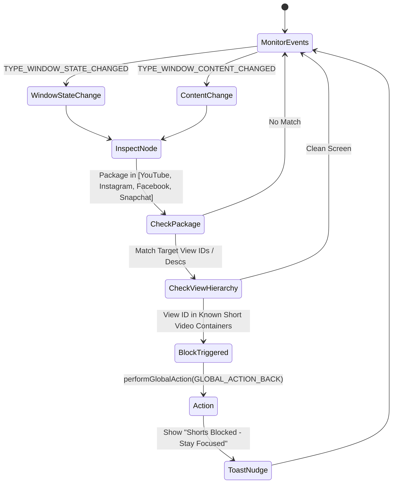

# Feature Specification & Technical Implementation Guide

This specification details the technical implementation, algorithmic state machines, and data contracts for replicating all core and premium features of the Minimalist Phone Launcher.

---

## 1. Short Video / Reels Blocker Engine

### Objective
Prevent users from falling into doom-scrolling loops inside otherwise necessary applications (e.g. using YouTube for lectures or Instagram for DMs while neutralizing addictive short feeds).

### Algorithm


### Known Target View Identifiers
- **YouTube Shorts:**
  - Package: `com.google.android.youtube`
  - View IDs / Classes: `shorts_container`, `reel_player_page_tree`, `shorts_shelf`, `pivot_bar_shorts`
- **Instagram Reels:**
  - Package: `com.instagram.android`
  - View IDs / Descs: `clips_viewer_view_pager`, `reels_tray_container`, ContentDesc: "Reels"
- **Facebook Stories / Reels:**
  - Package: `com.facebook.katana`
  - View IDs: `fb_shorts_viewer_container`, `stories_tray`
- **Snapchat Spotlight:**
  - Package: `com.snapchat.android`
  - View IDs: `spotlight_tab_container`

---

## 2. In-App Floating Time Reminder & Lockout

### Architecture
- Utilizes an Android `Service` paired with `SYSTEM_ALERT_WINDOW`.
- `WindowManager.LayoutParams`:
  - `type = TYPE_APPLICATION_OVERLAY`
  - `flags = FLAG_NOT_FOCUSABLE or FLAG_NOT_TOUCH_MODAL`
  - `format = PixelFormat.TRANSLUCENT`
  - `gravity = Gravity.TOP or Gravity.START`

### State Machine
```
[User Launches Distracting App]
            │
            ▼
[Check Mindful Launch Delay Enabled?]
    ├── YES ──► Display 15s Breathing Modal ("Breathe... Launching in 15s")
    │           └── [Cancel Button] ──► Return to Home Screen
    └── NO / Timer Ends ──► Launch Target App
            │
            ▼
[Start Floating Countdown Progress Bar (e.g., 10 min)]
            │
            ▼
[Time Runs Out]
            │
            ├──► If Mode == "Exit and block for X min"
            │       └── Call GLOBAL_ACTION_HOME, block app until timer finishes
            │
            ├──► If Mode == "Mindful Extension Delay"
            │       └── Show Modal: "Wait 30s to add 5 minutes"
            │
            └──► If Mode == "Only remind"
                    └── Vibrate + Notification chime
```

---

## 3. Notification Filter & Digest Batching

### Data Model
```kotlin
data class FilteredNotification(
    val id: Long = 0,
    val packageName: String,
    val appName: String,
    val title: String?,
    val text: String?,
    val timestamp: Long,
    val sbnKey: String,
    val isRead: Boolean = false
)
```

### Workflow
1. `NotificationFilterService` extends `NotificationListenerService`.
2. On `onNotificationPosted(sbn: StatusBarNotification)`:
   - Check if `sbn.packageName` is inside `PreferencesManager.getFilteredPackages()`.
   - If filtered:
     - Record details into SQLite/Room `FilteredNotification` table.
     - Call `cancelNotification(sbn.key)`.
3. In-App View: Users view notifications inside the launcher at designated mindful break times rather than being interrupted continuously.

---

## 4. Monochrome Mode Engine

### Mechanism
Requires one-time ADB permission grant:
```bash
adb shell pm grant com.minimalist.launcher android.permission.WRITE_SECURE_SETTINGS
```

### Implementation
```kotlin
object MonochromeController {
    private const val DALTONIZER_ENABLED = "accessibility_display_daltonizer_enabled"
    private const val DALTONIZER = "accessibility_display_daltonizer"
    private const val MONOCHROME_VALUE = 0 // Grayscale simulation

    fun setMonochromeEnabled(context: Context, enabled: Boolean) {
        val resolver = context.contentResolver
        try {
            Settings.Secure.putInt(resolver, DALTONIZER_ENABLED, if (enabled) 1 else 0)
            if (enabled) {
                Settings.Secure.putInt(resolver, DALTONIZER, MONOCHROME_VALUE)
            }
        } catch (e: SecurityException) {
            // WRITE_SECURE_SETTINGS not yet granted via ADB
        }
    }
}
```

---

## 5. Circular Battery & Digital Clock Canvas Widget

### Visual Spec
- **Digital Time:** Rendered in large minimalist typography (e.g., `18:51`) using clean monospace/sans weights.
- **Date:** Centered below the time in mixed case (`Sunday, 25th October`).
- **Circular Progress Arc:**
  - Drawn using `Canvas.drawArc()`.
  - Radius: Dynamic bounds matching parent circle view.
  - Background circle stroke: Subtle faint gray (`#222222`).
  - Active battery arc: Pure white (`#FFFFFF`) representing 0% to 100% of current device battery status.
  - Battery listener: `BroadcastReceiver` listening to `Intent.ACTION_BATTERY_CHANGED`.
  - Tapping Clock: Launches system default Clock/Alarm.
  - Tapping Date: Launches system default Calendar.

---

## 6. Fast Alphabet Scrubber & Instant Fuzzy Search

### Alphabet Bar
- List of letters: `['A', 'B', 'C', ..., 'Z', '★']`.
- Touch Listener on right border:
  ```kotlin
  val touchY = event.y
  val letterIndex = (touchY / totalHeight * alphabet.size).toInt().coerceIn(0, alphabet.size - 1)
  val selectedLetter = alphabet[letterIndex]
  // Scroll RecyclerView to first app starting with selectedLetter
  // Trigger haptic vibration tick
  ```
- **Fuzzy Search:** Filter app names on every character input in under 4ms using sub-string & prefix matching without frame drops.
