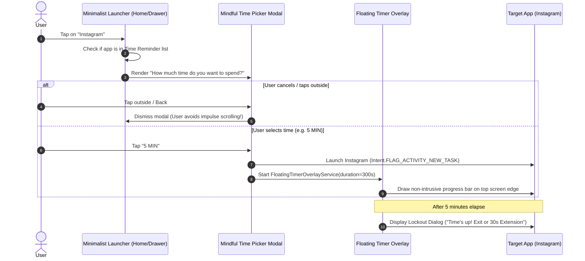

# Instagram & App Launch Modal Inspection

During live testing via ADB on the target device, tapping **Instagram** (`com.instagram.android`) inside Minimalist Phone intercepted the launch and presented a dedicated mindful decision modal before allowing access.

---

## 📸 Captured Modal Structure & Hierarchy

When tapping Instagram, instead of immediately opening the app, Minimalist Phone triggers an intentional barrier:

### 1. Default Compact Modal
- **App Title:** `Instagram` (resource-id: None, bounds: `[96, 771][313, 839]`)
- **Question Prompt:**  
  > *"How much time do you want to spend on Instagram now?"*  
  (bounds: `[96, 851][984, 1013]`)
- **Quick Pick Options:**
  - **`5 MIN`** (bounds: `[96, 1075][372, 1290]`)
  - **`10 MIN`** (bounds: `[402, 1075][678, 1290]`)
  - **`15 MIN`** (bounds: `[708, 1075][984, 1290]`)
- **Expand Toggle:**  
  Down-arrow button `expand_arrow_image_view_dialog_set_app_timer` (bounds: `[468, 1338][612, 1482]`)

---

### 2. Expanded Time Customization Modal
Tapping the down arrow expands the modal with granular time settings:
- **Section Heading:** `Custom time`
- **Interactive Controls:**
  - Decrement `-` button
  - Minute counter: e.g. `60 MINUTES`
  - Increment `+` button
  - Action Button: `button_open_with_custom_minutes_dialog_set_app_timer`
- **Footer Control:**
  - `button_more_settings_dialog_set_app_timer` ("More settings") -> routes directly to the in-app time reminder configuration for this specific app.

---

## 🧠 Behavioral Psychology & Execution Flow

