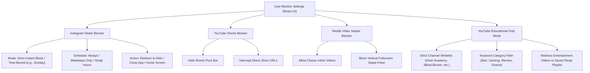

# Short-Form Video & Content Filter Specification
## (Instagram Reels, YouTube Shorts, Reddit Video Feed & Educational-Only YouTube)

This document specifies the technical architecture, heuristic pattern-matching engine, and granular user customization options for selectively blocking addictive video feeds (Reels, Shorts, Reddit Video scrolls) and restricting YouTube strictly to educational content.

---

## 🎯 Executive Summary & Threat Model

Social media platforms deliberately mix utility (DMs, educational videos, forums) with highly addictive, slot-machine-style vertical video feeds:
- **Instagram:** Direct Messaging is essential for communication, but the "Reels" tab induces uncontrolled doom-scrolling.
- **YouTube:** Educational tutorials, courses, and documentation videos are critical tools, but "Shorts" and entertainment/clickbait rabbit holes derail focus.
- **Reddit:** Text-based discussions, coding forums (e.g. r/cpp, r/reactnative), and tech news are productive, but tapping any video enters a vertical TikTok-style swipe carousel.

Our engine decouples the **utility** from the **dopamine loop** using a native **C++ / Go Obfuscated Accessibility Engine** paired with a **React Native Configuration Layer**.

---

## ⚙️ Granular User Configuration & Parameters

Every blocker rule exposes flexible parameters so users can tune restrictions to their individual willpower and workflow needs.



---

## 1. 📸 Instagram Reels Blocker Specification

### Configurable Parameters
| Parameter | Type | Options / Range | Default | Purpose |
|---|---|---|---|---|
| `reels_block_mode` | Enum | `STRICT_BLOCK`, `TIME_BOXED`, `FRICTION_DELAY` | `STRICT_BLOCK` | Instantly kill vs allow limited daily dose. |
| `reels_daily_allowance_min` | Integer | 0 to 60 minutes | `0` | Daily budget for Reels; resets at midnight. |
| `reels_friction_pause_sec` | Integer | 5 to 30 seconds | `15` | Breathing countdown before allowing Reels. |
| `reels_allowed_schedule` | Schedule | Custom Days & Hours (e.g., weekends only) | `Always Blocked` | Restrict Reels during work/study hours. |
| `reels_exit_target` | Enum | `HOME_SCREEN`, `REDIRECT_TO_INBOX`, `BACK` | `REDIRECT_TO_INBOX` | Send user directly to DMs instead of killing Instagram. |

### Technical Detection Heuristics (Native C++ Engine)
Instagram uses dynamic view hierarchies across updates. The C++ engine uses multi-factor signature evaluation:
1. **Target Package:** `com.instagram.android`
2. **View Identifier Signatures:**
   - `clips_viewer_view_pager`: Fullscreen vertical scroll container.
   - `reel_viewer_root`: Stories and Reels combined viewer container.
   - `reels_tab`: Bottom navigation tab bar icon for Reels.
   - `clips_video_container`: ExoPlayer surface rendering vertical video.
3. **Accessibility Event Filter:**
   - `AccessibilityEvent.TYPE_VIEW_CLICKED` on bottom tab where `contentDescription == "Reels"`
   - `AccessibilityEvent.TYPE_WINDOW_CONTENT_CHANGED` containing `clips_viewer`
4. **Enforcement Action:**
   - Call `performGlobalAction(GLOBAL_ACTION_BACK)` twice or trigger an explicit intent to open Instagram Direct:
     ```
     instagram://direct_v2
     ```

---

## 2. 🔴 YouTube Shorts Blocker Specification

### Configurable Parameters
| Parameter | Type | Options | Default | Purpose |
|---|---|---|---|---|
| `shorts_block_enabled` | Boolean | `true` / `false` | `true` | Master switch for YouTube Shorts. |
| `hide_shorts_pivot_tab` | Boolean | `true` / `false` | `true` | Prevents tapping the Shorts tab in bottom navigation. |
| `intercept_shorts_shelf` | Boolean | `true` / `false` | `true` | Auto-skips past Shorts carousels on Home/Search feeds. |
| `shorts_action` | Enum | `INSTANT_BACK`, `GO_TO_SUBSCRIPTIONS`, `HOME` | `INSTANT_BACK` | Where to navigate when Shorts is clicked. |

### Technical Detection Heuristics
1. **Target Package:** `com.google.android.youtube`
2. **View Identifier Signatures:**
   - `reel_player_page_tree`: Android Compose / View tree for Shorts player.
   - `shorts_container`: Outer frame layout of the Shorts feed.
   - `pivot_bar_shorts`: The bottom bar Shorts navigation item.
   - `reel_recycler`: Infinite recycler adapter for short vertical clips.
3. **Enforcement Action:**
   - Intercept and trigger `performGlobalAction(GLOBAL_ACTION_BACK)`.
   - Display a lightweight native toast or subtle HUD: *"Shorts Blocked — Stay Mindful"*.

---

## 3. 🟠 Reddit Video Scrolls Blocker Specification

### Problem Analysis
Reddit's native app (`com.reddit.frontpage`) allows viewing normal images, text posts, and comment threads. However, tapping any embedded video launches a fullscreen vertical video feed that mimics TikTok, infinitely loading unrelated videos as the user swipes up.

### Configurable Parameters
| Parameter | Type | Options | Default | Purpose |
|---|---|---|---|---|
| `reddit_swipe_feed_blocked` | Boolean | `true` / `false` | `true` | Neutralizes fullscreen video swipe loops. |
| `allow_inline_media` | Boolean | `true` / `false` | `true` | Permits playing a video directly inside a post body without launching fullscreen swipe mode. |
| `auto_mute_reddit_feed` | Boolean | `true` / `false` | `true` | Mutes autoplay video audio to prevent sensory capture. |

### Technical Detection Heuristics
1. **Target Package:** `com.reddit.frontpage`
2. **View Identifier Signatures:**
   - `video_feed_recycler_view` / `media_viewer_pager`: Fullscreen swipe container.
   - `feed_video_player_container`: Fullscreen interactive player with vertical swipe listener.
3. **Enforcement Action:**
   - Allow single tap to open the comments thread, but if `media_viewer_pager` is detected in active view state, trigger `GLOBAL_ACTION_BACK` immediately to keep user on the text post comments rather than the endless video queue.

---

## 4. 🎓 YouTube "Educational-Only" Mode Filter

### Problem Analysis
YouTube is the world's greatest educational repository (CS lectures, math, physics, coding tutorials), but the algorithm aggressively pushes entertainment, reaction videos, gaming streams, and political drama.

### Architecture: Multi-Tier Educational Filter

```
[User Taps Video on YouTube]
             │
             ▼
[Accessibility Engine Extracts Metadata]
  - Video Title (TextView)
  - Channel Name (TextView)
  - Description / Hashtags
             │
             ▼
[C++ Heuristic Classification Engine]
             │
   ┌─────────┴─────────┐
   ▼                   ▼
[Approved / Edu]   [Blocked / Entertainment]
   │                   │
   ▼                   ▼
Allow Playback     - Pause Video Immediately
                   - Show React Modal: "Entertainment Video Blocked"
                   - Option: "Redirect to Khan Academy / Saved Course"
```

### Configurable Parameters
| Parameter | Type | Description | Default |
|---|---|---|---|
| `edu_mode_enabled` | Boolean | Activates strict educational filtering on YouTube. | `false` (Opt-in) |
| `strictness_level` | Enum | `WHITELIST_ONLY`, `KEYWORD_AI_FILTER`, `BALANCED` | `BALANCED` |
| `channel_whitelist` | List<String> | Approved channels (e.g., *MIT OpenCourseWare, freeCodeCamp, 3Blue1Brown, Veritasium, Lex Fridman, Computerphile*). | Pre-populated curated list |
| `blocked_categories` | List<String> | Banned topics: *Gaming, Vlogs, Drama, Celebrity Gossip, Pranks, Reaction, Entertainment*. | All checked |
| `allow_search_override` | Boolean | Allow watching non-whitelisted videos only if explicitly searched for study queries. | `false` |

### Technical Implementation Mechanism
1. When a video opens in `com.google.android.youtube`, the accessibility tree exposes `video_title` and `channel_name` nodes.
2. The native C++ engine evaluates:
   - **Whitelist Match:** If channel matches user's approved list -> **ALLOW**.
   - **Blacklist Match:** If title contains clickbait triggers (`"PRANK"`, `"REACTION"`, `"FORTNITE"`, `"GTA"`, `"DRAMA"`, `"VLOG"`, `"CHALLENGE"`, `"SHOCKING"`) -> **BLOCK**.
   - **Positive Educational Match:** Words like `Tutorial`, `Lecture`, `Course`, `Architecture`, `Explained`, `Code`, `Engineering`, `Calculus`, `History`, `Physics` -> **ALLOW**.
3. If blocked:
   - Perform `accessibilityAction` click on `pause_button`.
   - Bring up overlay dialog or redirect user to home screen.

---

## 🛡️ Anti-Tamper & Native String Obfuscation (C++ / Go)

To prevent social media apps from breaking heuristics when updating view IDs, the C++ engine:
1. **Never stores plain-text strings** in the binary. All strings are stored as encrypted byte arrays (AES-128 or XOR + bit-shift hash).
2. **Fuzzy Class Name Analysis:** Evaluates view hierarchy patterns (e.g. view depth, aspect ratio 9:16, layout parameters) in addition to resource IDs.
3. **OTA Heuristic Rule Updates:** The React layer can download updated JSON signature patterns without requiring a complete app recompile.
